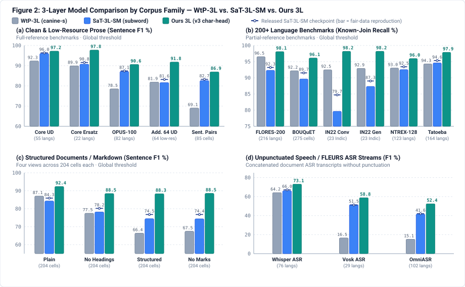
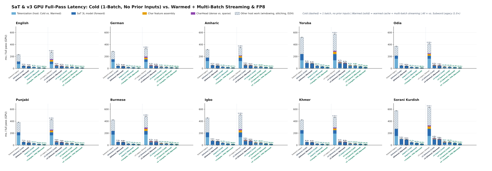
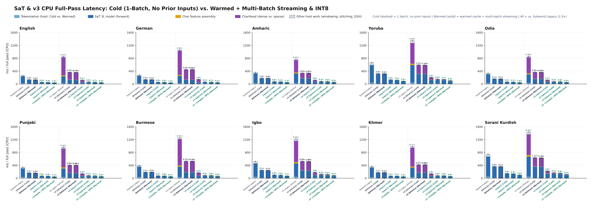

# Multilingual sentence segmentation in wtpsplit v3

Existing neural segmenters trade broad script coverage against robustness on noisy text. Character-level CANINE models (`WtP`) handle low-resource and unspaced scripts well, but lag on clean high-resource prose and break on unpunctuated speech transcripts. Subword XLM-RoBERTa models (`SaT`, `SaT-SM`) improve high-resource accuracy and speed, but lose recall across many FLORES, BOUQuET, and Indic languages (`IN22`).

`wtpsplit` v3 keeps the 3-layer and 12-layer XLM-RoBERTa footprint and two-stage training structure of `SaT` (`Stage 1`) and `SaT-SM` (`Stage 2`), combining three changes:

- `Broader multilingual pretraining and supervision (200+ languages)`: expands Stage 1 paragraph pretraining from mC4 (85 languages) to `FineWeb` and `FineWeb2` across 288 languages with script-aware spacing, and combines curated Stage 2 sentence corpora with parallel bitext projection across 200+ NLLB, FLORES, and BOUQuET languages.
- `Style- and format-agnostic training`: trains across clean prose, unpunctuated text, and structured document formatting so the model does not rely on single surface cues such as terminal punctuation, join whitespace, or Markdown block markers.
- `Character-level boundary resolution`: attaches a lightweight character-resolution head on top of the 3L/12L XLM-RoBERTa subword backbone to predict boundary probabilities at every character position rather than only at subword token ends, removing the recall ceiling on unspaced scripts, glued words, and inline markup while keeping subword encoder speed.

## 1. Empirical results at a single global threshold

Every model below is scored at a single global threshold per checkpoint ($\tau = 0.35$ for our 3L model, $\tau = 0.40$ for our 12L model, $\tau = 0.01$ for `WtP-3L` with language adapters and fallback) using a `512 / 64` sliding window and no per-corpus threshold tuning.



### A. Full-reference benchmarks (package F1, %)

| Benchmark panel | Cells | **Ours 12L** | **Ours 3L** | **Fair SaT-3L-SM** | **Released SaT-3L-SM** | **WtP-3L (`canine-s`)** | **3L vs. Fair SM** |
|---|---:|---:|---:|---:|---:|---:|---:|
| **Core UD** (high/mid-resource standard) | 55 | **98.01** | 97.22 | 96.04 | 96.34 | 92.35 | **+1.18** |
| **Additional 64 UD** (low-resource and unseen scripts) | 64 | **93.73** | 91.79 | 81.62 | 83.18 | 81.89 | **+10.17** |
| **Core OPUS-100** | 82 | **93.41** | 90.59 | 87.13 | 87.39 | 78.52 | **+3.47** |
| **Core Ersatz** | 22 | **98.62** | 97.76 | 90.75 | 91.60 | 89.92 | **+7.01** |
| **Sentence pairs** (2-sentence calibration) | 85 | **89.54** | 86.94 | 82.66 | 83.24 | 69.06 | **+4.28** |
| **FLEURS ASR: Whisper** (unpunctuated stream) | 76 | **74.94** | 73.06 | 66.02 | 67.10 | 64.16 | **+7.04** |
| **FLEURS ASR: Vosk** (unpunctuated stream) | 29 | **67.45** | 58.82 | 51.47 | 51.20 | 16.52 | **+7.35** |
| **FLEURS ASR: OmniASR** (unpunctuated stream) | 102 | **65.41** | 52.43 | 41.57 | 42.02 | 15.14 | **+10.87** |
| **Markdown [plain]** | 204 | **92.72** | 92.41 | 84.32 | 85.90 | 87.07 | **+8.09** |
| **Markdown [structured]** | 204 | **89.01** | 88.35 | 74.45 | 76.80 | 66.39 | **+13.90** |
| **Markdown [no_marks]** | 204 | **89.10** | 88.55 | 74.42 | 76.80 | 67.47 | **+14.13** |

### B. Partial-reference benchmarks across 200+ languages (known-join recall % / cut density)

Cut density is total predicted cuts divided by known gold joins; values closer to `1.00×` indicate fewer extra splits.

| Benchmark panel | Cells / langs | **Ours 12L** | **Ours 3L** | **Fair SaT-3L-SM** | **Released SaT-3L-SM** | **WtP-3L (`canine-s`)** | **3L vs. Fair SM** |
|---|---:|---:|---:|---:|---:|---:|---:|
| **FLORES-200** (NLLB / SONAR articles) | 216 | 98.00% (`1.21×`) | **98.11%** (`1.20×`) | 92.33% (`1.32×`) | 93.21% (`1.30×`) | 96.54% (`1.34×`) | **+5.77 pt recall** |
| **BOUQuET** (multi-domain paragraphs) | 275 | 95.97% (`1.06×`) | **96.12%** (`1.08×`) | 89.66% (`1.14×`) | 91.51% (`1.13×`) | 92.18% (`1.17×`) | **+6.47 pt recall** |
| **IN22 Conv** (23 Indic languages, conversational) | 23 | 96.47% (`1.06×`) | **98.19%** (`1.10×`) | 79.65% (`1.32×`) | 84.72% (`1.33×`) | 92.49% (`1.42×`) | **+18.54 pt recall** |
| **IN22 Gen** (23 Indic languages, general domain) | 23 | 98.10% (`1.01×`) | **98.20%** (`1.03×`) | 87.35% (`1.47×`) | 89.01% (`1.45×`) | 92.92% (`1.44×`) | **+10.85 pt recall** |
| **NTREX-128** (news translation) | 123 | **97.21%** (`1.03×`) | 95.95% (`1.04×`) | 92.53% (`1.19×`) | 93.40% (`1.17×`) | 93.03% (`1.26×`) | **+3.42 pt recall** |
| **Tatoeba** (low-resource sentence pairs) | 164 | 97.85% (`1.01×`) | **97.88%** (`1.01×`) | 94.61% (`1.03×`) | 95.35% (`1.02×`) | 94.30% (`0.99×`) | **+3.27 pt recall** |

These numbers are a current working snapshot from a single training seed (seed 42) while final ablations and 12L-to-3L distillation are in progress.

---

## 2. Inference latency and operating modes (GPU and CPU)

`wtpsplit` v3 accelerates both existing subword checkpoints (`sat-3l`, `sat-3l-sm`, `sat-12l-sm`) and the new character-resolution checkpoints (`v3`) across three explicit numerical contracts (`mode="bitwise" | "equivalent" | "sparse"`), plus optional `torch.compile`, `FlexAttention`, and hardware `FP8` / `INT8` execution.

Each language panel below compares **Subword (`SaT-3L-SM`, left 6 bars)** and **`v3` (`CharacterResolutionHead`, right 7 bars)** under both **Cold (`(Cold)`, dashed outline: a single 128-document batch with no prior inputs)** and **Warmed (`(Warmed)`, solid outline: warmed word cache + double-buffered multi-batch host/GPU streaming)** execution. All speedup multipliers (`×`) are relative to **`Subword Legacy` (`1.0×`)**.





### Mapping figure bars to `SaT(...)` configuration options

| Bar in Figure 2 & Figure 3 | How to Configure in `SaT(...)` | Numerical Contract | What It Enables |
|---|---|---|---|
| **`[bitwise]` *(Default)*** | `SaT(ckpt)` *(or `mode="bitwise"`)* | **`0.0` ULP bit-identical** | Fast Rust/word-cached tokenization, single-pass UTF-32 character feature assembly, ring-factorized 1-lookup CANINE `[8192, 64]` residue table, zero-transpose depthwise conv, fused `QKV` projection, 65,536-entry `float16` sigmoid LUT, and 2-slot pinned H2D + multi-chunk host prefetching. |
| **`[equiv]`** | `SaT(ckpt, mode="equivalent")` *(or `sat.set_mode("equivalent")`)* | **Exact math (`<= 2e-6` in `fp32`, `0.00` F1 delta)** | Everything in `bitwise` + length-sorted dynamic window trimming (`trim_subword_padding=True`), unpadded 1D `varlen` sequence packing with run-grouped 3D block-diagonal SDPA (`pack_sequences=True`), algebraically fused `depthwise + delta` linear readout, and 3-way `F.embedding_bag` over pre-projected `[8192, 128]` / `[32, 128]` character LUTs. |
| **`[sparse]`** | `SaT(ckpt, mode="sparse")` *(or `sat.set_mode("sparse")`)* | **$r=2$ receptive-field token gating (`0.00` F1 delta)** | Everything in `equivalent` + two-stage coarse-to-fine character evaluation (`gate_logit_threshold=-4.0`, evaluating the character residual only on candidate tokens plus their $\pm 2$-character convolutional halo) and fused `[B, 2*T+1, L]` base+suppression lookup. |
| **`+Compile / FP8` *(GPU)*** | `SaT(ckpt, device="cuda", mode="sparse", compile=True)` or `SaT(ckpt, device="cuda", mode="sparse", precision="fp8")` | **Compiled / `float8_e4m3fn` Tensor Cores** | Bucketed `torch.compile(..., mode="reduce-overhead")` + `FlexAttention` block masks, or row-wise (`per-token × per-channel`) `float8_e4m3fn` Tensor Core matrix multiplications (`torch._scaled_mm` on Ada L40S / Hopper H100 GPUs). |
| **`+Compile / INT8` *(CPU)*** | `SaT(ckpt, device="cpu", mode="sparse", quantization="int8")` *(or `compile=True`)* | **Dynamic `INT8` encoder Linears + row-wise `INT8` vocab** | Combines `mode="sparse"` (`varlen` packing + 1-lookup residue table + sparse character head) with dynamic `qint8` encoder linear layers and row-wise `uint8` vocabulary quantization on CPU. |

---

## 3. Installation and usage

Install the v3 inference branch from GitHub:

```bash
pip install "git+https://github.com/segment-any-text/wtpsplit.git@v3/inference-preview"
```

```python
from wtpsplit import SaT
from wtpsplit._inference_session import InferenceSession, InferenceSettings

# 1. Default bit-exact mode (mode="bitwise", 0.0 ULP; works identically on v3, "sat-3l-sm", and "sat-3l")
sat = SaT("/path/to/checkpoint", device="cuda")          # or device="cpu"
sentences = sat.split(text_or_stream)                    # uses checkpoint default τ (0.35 for 3L, 0.40 for 12L), 512/64

# 2. Switch modes in-place without reloading weights: "bitwise" -> "equivalent" -> "sparse"
sat.set_mode("equivalent")                               # unpadded varlen packing + fused conv/readout + pre-projected LUTs
sat.set_mode("sparse")                                   # + two-stage r=2 token-gated character head (recommended for v3)
sentences = sat.split(text_or_stream)

# 3. Maximum hardware throughput: torch.compile / FlexAttention, GPU FP16/FP8, or CPU INT8/BF16
sat_gpu_fast = SaT("/path/to/checkpoint", device="cuda", mode="sparse", compile=True)
sat_gpu_fp8  = SaT("/path/to/checkpoint", device="cuda", mode="sparse", precision="fp8")     # Ada (L40S) / Hopper (H100)
sat_cpu_int8 = SaT("/path/to/checkpoint", device="cpu",  mode="sparse", quantization="int8") # CPU INT8

# 4. Structured output (sentences, half-open character spans, probabilities, boundary confidences)
seg = sat.segment(text_or_stream)                        # seg.sentences, seg.spans, seg.probabilities, seg.confidences

# 5. Explicit multiprocess session (bounded worker pool + double-buffered pinned GPU transfer)
with InferenceSession(sat, InferenceSettings(batch_size=64, workers=4, pinned_inputs=True)) as session:
    char_probs = session.probabilities(documents)
```
