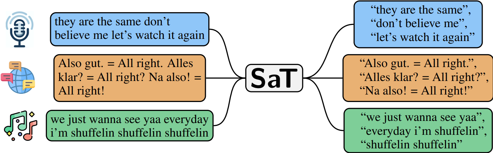

> **Note:** See [OVERVIEW.md](OVERVIEW.md) for the v3 architecture, 200+ language & ASR results, and v3 inference pipeline usage.

<h1 align="center">wtpsplit🪓</h1>
<h3 align="center">Segment any Text - Robustly, Efficiently, Adaptably⚡</h3>

This repository allows you to segment text into sentences or other semantic units. It implements the models from:

- **SaT** &mdash; [Segment Any Text: A Universal Approach for Robust, Efficient and Adaptable Sentence Segmentation](https://arxiv.org/abs/2406.16678) by Markus Frohmann, Igor Sterner, Benjamin Minixhofer, Ivan Vulić and Markus Schedl (**state-of-the-art, encouraged**).
- **WtP** &mdash; [Where’s the Point? Self-Supervised Multilingual Punctuation-Agnostic Sentence Segmentation](https://aclanthology.org/2023.acl-long.398/) by Benjamin Minixhofer, Jonas Pfeiffer and Ivan Vulić (*previous version, maintained for reproducibility*).

The namesake WtP is maintained for consistency. Our new followup SaT provides robust, efficient and adaptable sentence segmentation across 85 languages at higher performance and less compute cost. Check out the **state-of-the-art** results in 8 distinct corpora and 85 languages demonstrated in our [Segment any Text paper](https://arxiv.org/abs/2406.16678).



## Installation

Install the downloaded preview wheel from its directory.

```bash
python -m pip install ./wtpsplit-3.0.1.dev20261126-py3-none-any.whl
```

## Usage

```python
from wtpsplit import SaT

sat = SaT("sat-3l")
# optionally run on GPU for better performance
# also supports TPUs via e.g. sat.to("xla:0"), in that case pass `pad_last_batch=True` to sat.split
# sat.half().to("cuda")

sat.split("This is a test This is another test.")
# returns ["This is a test ", "This is another test."]

# do this instead of calling sat.split on every text individually for much better performance
sat.split(["This is a test This is another test.", "And some more texts..."])
# returns one sentence list per input text

# use our '-sm' models for general sentence segmentation tasks
sat_sm = SaT("sat-3l-sm")
# sat_sm.half().to("cuda") # optional, see above
sat_sm.split("this is a test this is another test")
# returns ["this is a test ", "this is another test"]

# use trained lora modules for strong adaptation to language & domain/style
sat_adapted = SaT("sat-3l", domain="ud", language="en")
# sat_adapted.half().to("cuda") # optional, see above
sat_adapted.split("This is a test This is another test.")
# returns ['This is a test ', 'This is another test']
```

## Compiled and ONNX inference

For repeated PyTorch inference, enable compilation when constructing the model.

```python
from wtpsplit import SaT

sat = SaT("sat-3l-sm", compile=True)
sentences = sat.split("This is a test. This is another test.")
```

For ONNX inference, install the optional CPU or GPU runtime and select an available provider.

```python
from wtpsplit import SaT

sat = SaT("sat-3l-sm", ort_providers=["CPUExecutionProvider"])
```

## Available Models

If you need a general sentence segmentation model, use `-sm` models (e.g., `sat-3l-sm`)
For speed-sensitive applications, we recommend 3-layer models (`sat-3l` and `sat-3l-sm`). They provide a great tradeoff between speed and performance.
The best models are our 12-layer models: `sat-12l` and `sat-12l-sm`.

| Model                                                                        | English Score | Multilingual Score |
| :--------------------------------------------------------------------------- | ------------: | -----------------: |
| [sat-1l](https://huggingface.co/segment-any-text/sat-1l)                        |          88.5 |               84.3 |
| [sat-1l-sm](https://huggingface.co/segment-any-text/sat-1l-sm)                  |          88.2 |               87.9 |
| [sat-3l](https://huggingface.co/segment-any-text/sat-3l)                        |          93.7 |               89.2 |
| [sat-3l-lora](https://huggingface.co/segment-any-text/sat-3l/tree/main/loras)   |          96.7 |               94.8 |
| [sat-3l-sm](https://huggingface.co/segment-any-text/sat-3l-sm)                  |          96.5 |               93.5 |
| [sat-6l](https://huggingface.co/segment-any-text/sat-6l)                        |          94.1 |               89.7 |
| [sat-6l-sm](https://huggingface.co/segment-any-text/sat-6l-sm)                  |          96.9 |               95.1 |
| [sat-9l](https://huggingface.co/segment-any-text/sat-9l)                        |          94.3 |               90.3 |
| [sat-12l](https://huggingface.co/segment-any-text/sat-12l)                      |          94.0 |               90.4 |
| [sat-12l-lora](https://huggingface.co/segment-any-text/sat-12l/tree/main/loras) |          97.3 |               95.9 |
| [sat-12l-sm](https://huggingface.co/segment-any-text/sat-12l-sm)                |          97.4 |               96.0 |

The scores are macro-average F1 score across all available datasets for "English", and macro-average F1 score across all datasets and languages for "Multilingual". "adapted" means adapation via LoRA; check out the [paper](https://arxiv.org/abs/2406.16678) for details.

For comparison, here the English scores of some other tools:

| Model                                                    | English Score |
| :------------------------------------------------------- | ------------: |
| PySBD                                                    |          69.6 |
| SpaCy (sentencizer; monolingual)                         |          92.9 |
| SpaCy (sentencizer; multilingual)                        |          91.5 |
| Ersatz                                                   |          91.4 |
| Punkt (`nltk.sent_tokenize`)                           |          92.2 |
| [WtP (3l)](https://huggingface.co/benjamin/wtp-canine-s-3l) |          93.9 |

Note that this library also supports previous [`WtP`](https://arxiv.org/abs/2305.18893) models.
Install the optional legacy dependencies (`scikit-learn` and `skops`) before loading WtP models.

```python
from wtpsplit import WtP

wtp = WtP("wtp-bert-mini")
# similar functionality as for SaT models
wtp.split("This is a test This is another test.")
```

For more details on WtP and reproduction details, see the [WtP doc](./README_WTP.md).

## Paragraph Segmentation

Since SaT are trained to predict newline probablity, they can segment text into paragraphs in addition to sentences.

```python
# returns a list of paragraphs, each containing a list of sentences
# adjust the paragraph threshold via the `paragraph_threshold` argument.
text = "First sentence. Second sentence."
sat.split(text, do_paragraph_segmentation=True)
```

## Length budgets

Use `sat.split(text, max_length=120)` for a character budget. See the
[preview examples](OVERVIEW.md#length-budgets) for token budgets and chunking.

## Adaptation

SaT can be domain- and style-adapted via LoRA. We provide trained LoRA modules for Universal Dependencies, OPUS100, Ersatz, and TED (i.e., ASR-style transcribed speeches) sentence styles in 81 languages for `sat-3l`and `sat-12l`. Additionally, we provide LoRA modules for legal documents (laws and judgements) in 6 languages, code-switching in 4 language pairs, and tweets in 3 languages. For details, we refer to our [paper](https://arxiv.org/abs/2406.16678).

We also provided verse segmentation modules for 16 genres for `sat-12-no-limited-lookahead`.

Load LoRA modules like this:

```python

# requires both language and domain
# for available ones, check the <model_repository>/loras folder
sat_lora = SaT("sat-3l", domain="ud", language="en")
sat_lora.split("Hello this is a test But this is different now Now the next one starts looool")
# now for a highly distinct domain
sat_lora_distinct = SaT("sat-12l", domain="code-switching", language="es-en")
sat_lora_distinct.split("in the morning over there cada vez que yo decía algo él me decía algo")
```

You can also freely adapt the segmentation threshold, with a higher threshold leading to more conservative segmentation:

```python

sat.split("This is a test This is another test.", threshold=0.4)
# works similarly for lora; but thresholds are higher
sat_lora.split("Hello this is a test But this is different now Now the next one starts looool", threshold=0.7)
```

## Advanced Usage

### Get the newline or sentence boundary probabilities for a text:

```python
# returns newline probabilities (supports batching!)
sat.predict_proba(text)
```

### Load a SaT model in [HuggingFace `transformers`](https://github.com/huggingface/transformers):

```python
# import library to register the custom models 
import wtpsplit.models
from transformers import AutoModelForTokenClassification

model = AutoModelForTokenClassification.from_pretrained("segment-any-text/sat-3l-sm") # or some other model name; see https://huggingface.co/segment-any-text
```

Training and paper reproduction instructions are in the [main repository](https://github.com/segment-any-text/wtpsplit).

## Supported Languages

<details>
  <summary>Table with supported languages</summary>

| iso | Name            |
| :-- | :-------------- |
| af  | Afrikaans       |
| am  | Amharic         |
| ar  | Arabic          |
| az  | Azerbaijani     |
| be  | Belarusian      |
| bg  | Bulgarian       |
| bn  | Bengali         |
| ca  | Catalan         |
| ceb | Cebuano         |
| cs  | Czech           |
| cy  | Welsh           |
| da  | Danish          |
| de  | German          |
| el  | Greek           |
| en  | English         |
| eo  | Esperanto       |
| es  | Spanish         |
| et  | Estonian        |
| eu  | Basque          |
| fa  | Persian         |
| fi  | Finnish         |
| fr  | French          |
| fy  | Western Frisian |
| ga  | Irish           |
| gd  | Scottish Gaelic |
| gl  | Galician        |
| gu  | Gujarati        |
| ha  | Hausa           |
| he  | Hebrew          |
| hi  | Hindi           |
| hu  | Hungarian       |
| hy  | Armenian        |
| id  | Indonesian      |
| ig  | Igbo            |
| is  | Icelandic       |
| it  | Italian         |
| ja  | Japanese        |
| jv  | Javanese        |
| ka  | Georgian        |
| kk  | Kazakh          |
| km  | Central Khmer   |
| kn  | Kannada         |
| ko  | Korean          |
| ku  | Kurdish         |
| ky  | Kirghiz         |
| la  | Latin           |
| lt  | Lithuanian      |
| lv  | Latvian         |
| mg  | Malagasy        |
| mk  | Macedonian      |
| ml  | Malayalam       |
| mn  | Mongolian       |
| mr  | Marathi         |
| ms  | Malay           |
| mt  | Maltese         |
| my  | Burmese         |
| ne  | Nepali          |
| nl  | Dutch           |
| no  | Norwegian       |
| pa  | Panjabi         |
| pl  | Polish          |
| ps  | Pushto          |
| pt  | Portuguese      |
| ro  | Romanian        |
| ru  | Russian         |
| si  | Sinhala         |
| sk  | Slovak          |
| sl  | Slovenian       |
| sq  | Albanian        |
| sr  | Serbian         |
| sv  | Swedish         |
| ta  | Tamil           |
| te  | Telugu          |
| tg  | Tajik           |
| th  | Thai            |
| tr  | Turkish         |
| uk  | Ukrainian       |
| ur  | Urdu            |
| uz  | Uzbek           |
| vi  | Vietnamese      |
| xh  | Xhosa           |
| yi  | Yiddish         |
| yo  | Yoruba          |
| zh  | Chinese         |
| zu  | Zulu            |

</details>

For details, please see our [Segment any Text paper](https://arxiv.org/abs/2406.16678).

## Community Ports

- **Rust**: [wtsplit-rs](https://github.com/19h/wtsplit-rs) by [@19h](https://github.com/19h)

*Note: Community ports are independently maintained and may have different feature sets or update schedules.*

## Citations

For the `SaT` models, please kindly cite our paper:

```
@inproceedings{frohmann-etal-2024-segment,
    title = "Segment Any Text: A Universal Approach for Robust, Efficient and Adaptable Sentence Segmentation",
    author = "Frohmann, Markus  and
      Sterner, Igor  and
      Vuli{\'c}, Ivan  and
      Minixhofer, Benjamin  and
      Schedl, Markus",
    editor = "Al-Onaizan, Yaser  and
      Bansal, Mohit  and
      Chen, Yun-Nung",
    booktitle = "Proceedings of the 2024 Conference on Empirical Methods in Natural Language Processing",
    month = nov,
    year = "2024",
    address = "Miami, Florida, USA",
    publisher = "Association for Computational Linguistics",
    url = "https://aclanthology.org/2024.emnlp-main.665",
    pages = "11908--11941"
}

```

For the library and the WtP models, please cite:

```
@inproceedings{minixhofer-etal-2023-wheres,
    title = "Where{'}s the Point? Self-Supervised Multilingual Punctuation-Agnostic Sentence Segmentation",
    author = "Minixhofer, Benjamin  and
      Pfeiffer, Jonas  and
      Vuli{\'c}, Ivan",
    booktitle = "Proceedings of the 61st Annual Meeting of the Association for Computational Linguistics (Volume 1: Long Papers)",
    month = jul,
    year = "2023",
    address = "Toronto, Canada",
    publisher = "Association for Computational Linguistics",
    url = "https://aclanthology.org/2023.acl-long.398",
    pages = "7215--7235"
}
```

## Acknowledgments

This research was funded in whole or in part by the Austrian Science Fund (FWF): P36413, P33526, and DFH-23, and by the State of Upper Austria and the Federal Ministry of Education, Science, and Research, through grants LIT-2021-YOU-215. In addition, Ivan Vulic and Benjamin Minixhofer have been supported through the Royal Society University Research Fellowship ‘Inclusive and Sustainable Language Technology for a Truly Multilingual World’ (no 221137) awarded to Ivan Vulić. This research has also been supported with Cloud TPUs from Google’s TPU Research Cloud (TRC). This work was also supported by compute credits from a Cohere For AI Research Grant, these grants are designed to support academic partners conducting research with the goal of releasing scientific artifacts and data for good projects. We also thank Simone Teufel for fruitful discussions.

---

For any questions, please create an issue or send an email to markus.frohmann@gmail.com, and I will get back to you as soon as possible.
